# Asteria

Drop in a file, type what you want done to it, and get it back converted, resized, cleaned up or combined, on your own computer.

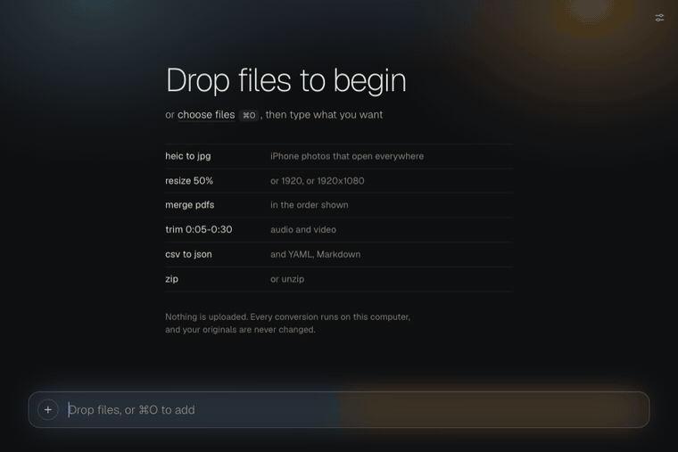

## Why

Every time I needed to turn a HEIC into a JPG, shrink a video for an email or pull the pages out of a PDF, I ended up on a website that wanted my file uploaded, my email address, or a monthly subscription, sometimes all three. Converting a file shouldn't be a subscription, and it shouldn't mean handing your files to someone else's server.

So Asteria is a small desktop app with one command bar. Drop files in, type `heic to jpg`, `resize 50%`, `merge pdfs`, `compress video` or `track stats`, watch the preview, and press <kbd>⌘</kbd><kbd>↵</kbd> (<kbd>Ctrl</kbd><kbd>↵</kbd> on Windows) to save. It works offline, it's free, and the code is right here. It grew out of [MoonCow](https://github.com/trevor050/mooncow), my keyboard-first command palette for Firefox: the same idea, applied to the files on your disk.

## What it can do

Asteria opens <!-- formats:count -->119<!-- /formats:count --> kinds of files, <!-- formats:builtin -->74<!-- /formats:builtin --> of them with nothing extra installed. Pictures, PDFs, data and config files, subtitles, email, fonts, maps, 3D models, archives and text are handled by code built into the app. Audio and video, office documents and ebooks use free add-ons that Asteria offers to download the first time you need one (see [Add-ons](#add-ons)).

Every conversion counted here was run on a real sample file, and its output was checked by a separate tool: an independent image reader, `ffprobe`, Python's own parsers, GDAL, Assimp, fontTools and so on. The numbers and the table below are generated from those results by [`scripts/formats/build.mjs`](scripts/formats/build.mjs), and the full list, with the add-on each conversion needs and the platforms it was verified on, is in [`docs/formats.json`](docs/formats.json).

<details>
<summary>Every verified conversion, by family</summary>

<!-- formats:start -->
<!-- Generated by scripts/formats/build.mjs from docs/formats.json. Do not edit by hand. -->

563 conversions between 119 file types, each tested on a real file with the result checked by a separate tool, on macOS on Apple silicon and Linux. "nothing" means it's built in; a name means Asteria offers that free add-on the first time you need it. The full list, with what each conversion needs, is in [docs/formats.json](docs/formats.json).

| Family | Opens | Saves as | Needs |
| --- | --- | --- | --- |
| Images | avif bmp dds gif heic heif ico jp2 jpeg jpg pbm pcx pgm png ppm psd ras sgi tga tif tiff webp xpm | heic jpg json png webp | nothing, ImageMagick |
| Vector | bmp gif heic heif jpeg jpg png svg tif tiff webp | png svg | Potrace, resvg |
| Color LUTs | 3dl cube | 3dl cube png | nothing |
| PDF | eps gif jpeg jpg pdf png ps webp | pdf txt | nothing, Ghostscript, Tesseract OCR |
| Documents | csv doc docx epub htm html ipynb markdown md odp ods odt org ppt pptx rst rtf tex textile xls xlsx | csv docx epub html md odp ods odt pdf pptx rst rtf tex txt xlsx | nothing, LibreOffice, Pandoc |
| Ebooks | azw3 epub fb2 mobi | azw3 epub mobi pdf txt | Calibre |
| Audio and video | aiff avi mkv mov mp4 ogg opus wav webm | aiff avi flac gif jpg m4a mkv mov mp3 mp4 ogg opus wav webm | FFmpeg |
| Subtitles | ass dfxp sbv srt ttml vtt | ass sbv srt ttml vtt | nothing |
| Data and config | cfg conf csv db env ini json jsonl markdown md ndjson parquet plist sqlite sqlite3 toml tsv xml yaml yml | csv env html ini json jsonl md plist sqlite toml tsv xml yaml | nothing |
| Text and encoding | txt | bin | nothing |
| Email | eml mbox mbx | csv html txt | nothing |
| Fonts | otf ttf woff woff2 | json otf ttf woff woff2 | nothing |
| Maps and GPS | csv geojson gpx kml kmz zip | csv geojson gpx json kml | nothing |
| 3D models | 3mf glb gltf obj ply stl | 3mf glb json obj ply stl | nothing |
| Archives | 7z bz2 gz tar.bz2 tar.gz tar.xz tar.zst tbz tbz2 tgz txz tzst wim xz zip zst | txt | nothing, 7-Zip |
| Any file | anything | 7z gz json tar.xz tar.zst txt xz zst | nothing, 7-Zip |

<!-- formats:end -->

</details>

Beyond conversions there are more than 100 picture skills (crop, straighten, levels, duotone, dither, vignette, watermark, collage, favicon and app-icon sets...), video edits (trim, speed, crop, rotate, mute, loudness, subtitles, contact sheets), PDF tools (merge, split, extract pages, compress), and helpers that work on any file: zip it, compress it, get its checksum, or ask what it really is.

<p>
  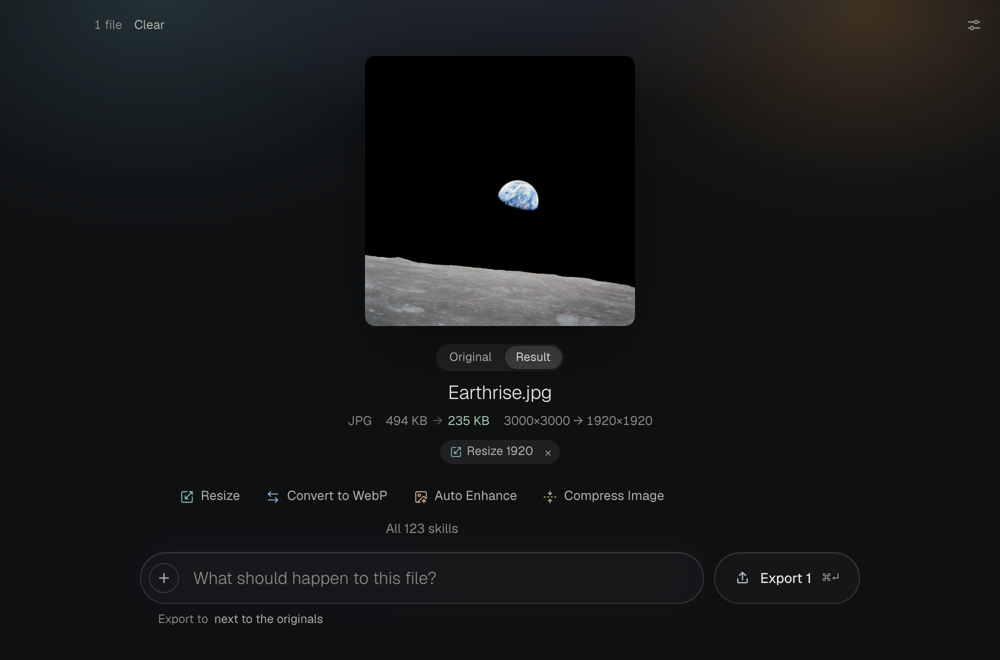
  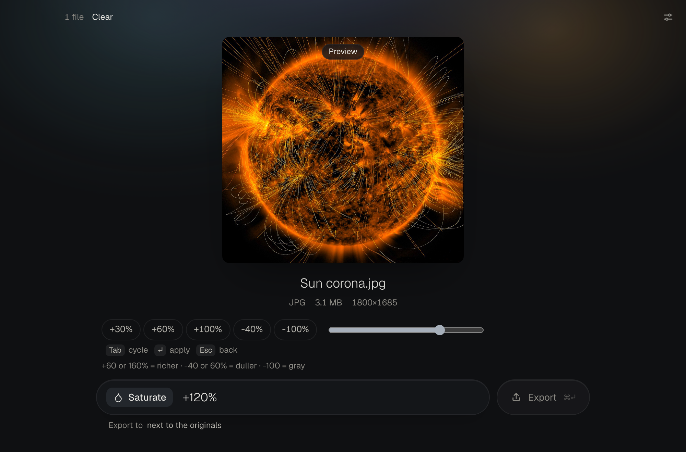
</p>
<p>
  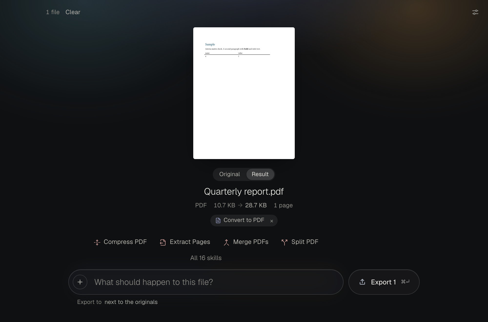
  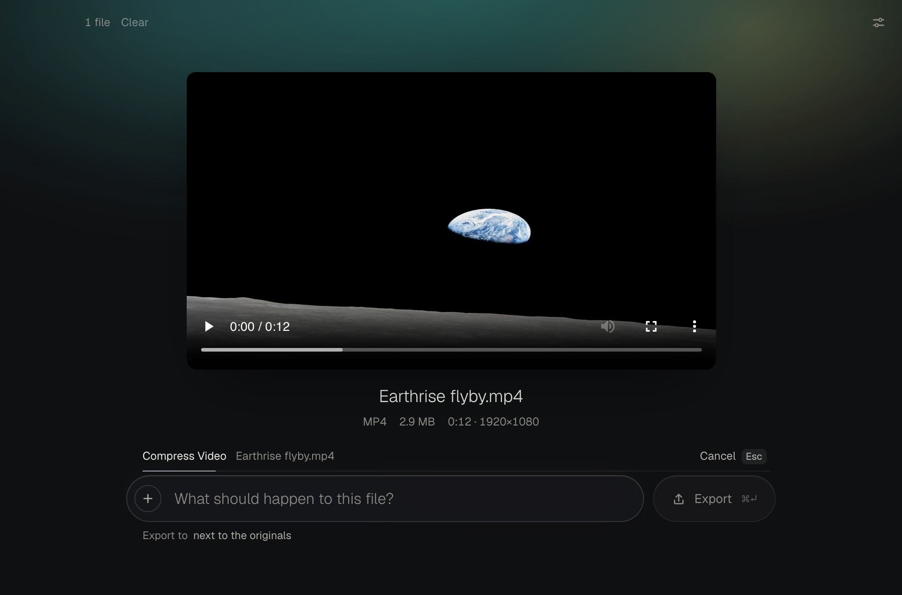
</p>
<p>
  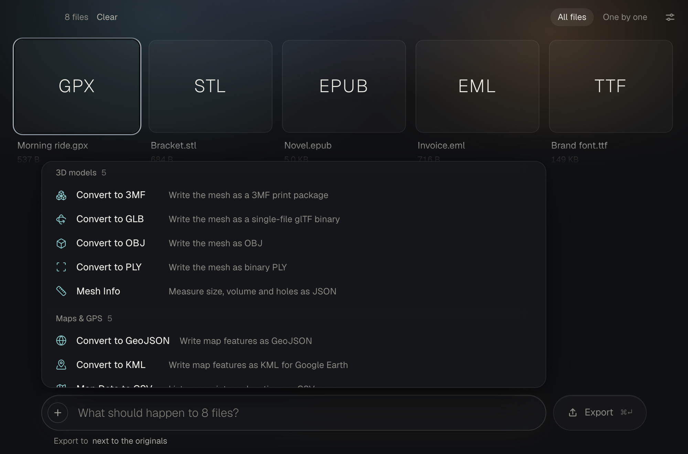
  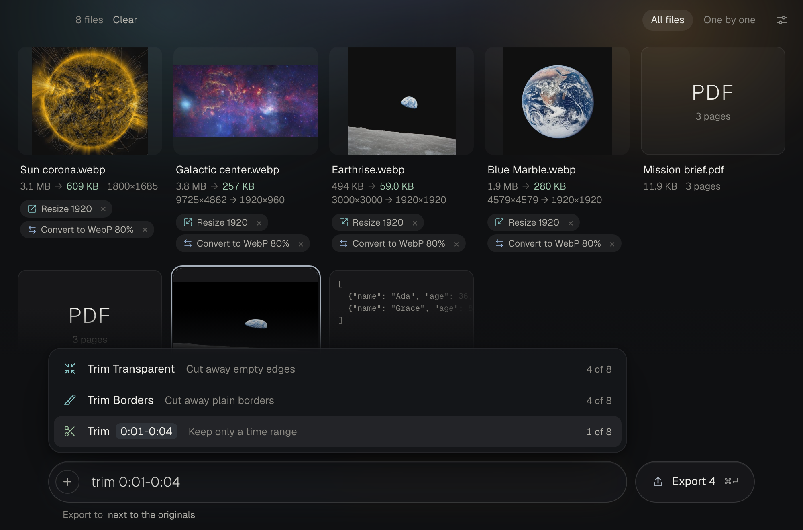
</p>
<p>
  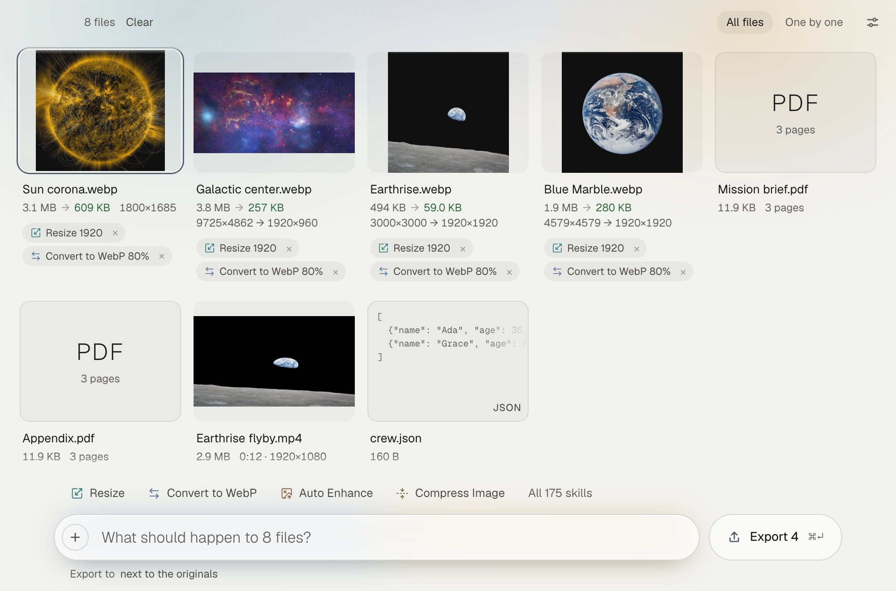
  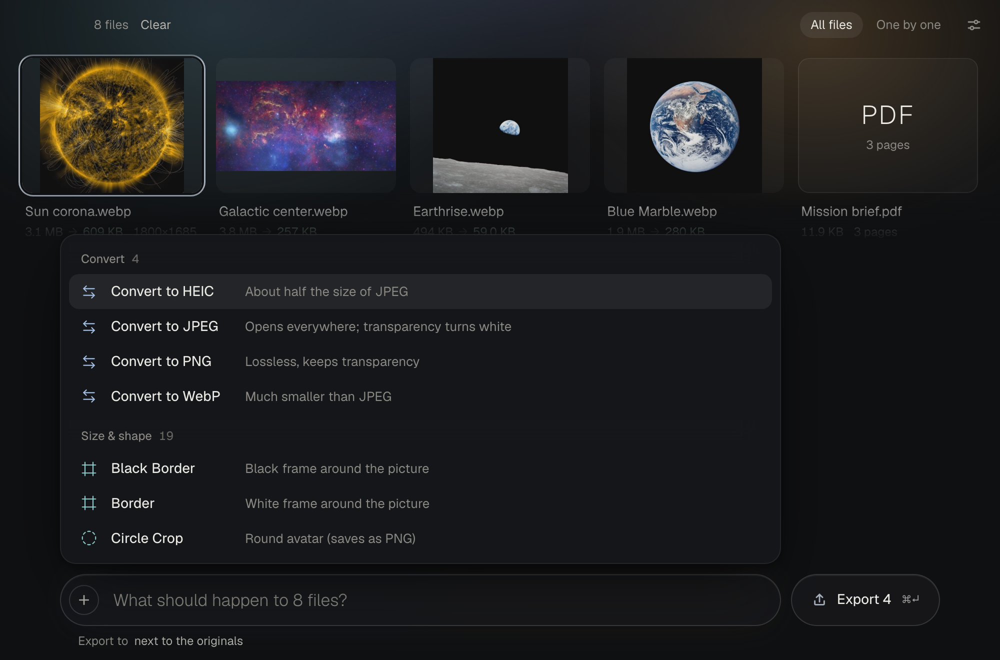
</p>

## How it works

- **Everything is a skill.** Converting, resizing, exporting and even picking the output folder live in the same command bar. A value after the name is used directly: `resize 50%`, `jpg 80`, `trim 0:05-0:30`.
- **It shows you what's next.** Drop files and the likely skills for those exact files sit above the bar, one click away. Skills that need an add-on are marked and ask before downloading anything.
- **Drag a value, see it live.** Skills with a number (saturation, exposure, blur, vignette...) get a slider, and the picture updates as you drag. Nothing is applied until you press <kbd>↵</kbd>.
- **Steps stack and can be undone.** Each file shows the chain it went through. Remove a step from the middle and the rest is replayed; <kbd>⌘</kbd><kbd>Z</kbd> undoes the last one.
- **Your originals are never touched.** Skills work on copies in a private workspace. Export writes new files next to the originals (or into a folder you pick) and never overwrites anything.
- **It looks like it belongs.** On macOS 26 the window itself is Liquid Glass, the system's own material. Light and dark follow your system, or pick one in Settings (<kbd>⌘</kbd><kbd>,</kbd>).

## Add-ons

Some formats need a big, well-established engine that it would be silly to rewrite. Asteria doesn't bundle them. The first time a file needs one, it tells you in plain words what it is, who makes it, that it's free, how big the download is, and how much space it will take. One click downloads it from the project's official release channel, checks it against the checksum pinned in [`addons/manifest.json`](addons/manifest.json), unpacks it into Asteria's own folder (no administrator password, nothing installed system-wide) and carries on with your conversion. **Settings → Add-ons** lists them all with their licenses, shows the space they use, and removes any of them with one click. Tools you already have (say, ffmpeg from Homebrew) are found and used as they are.

<p>
  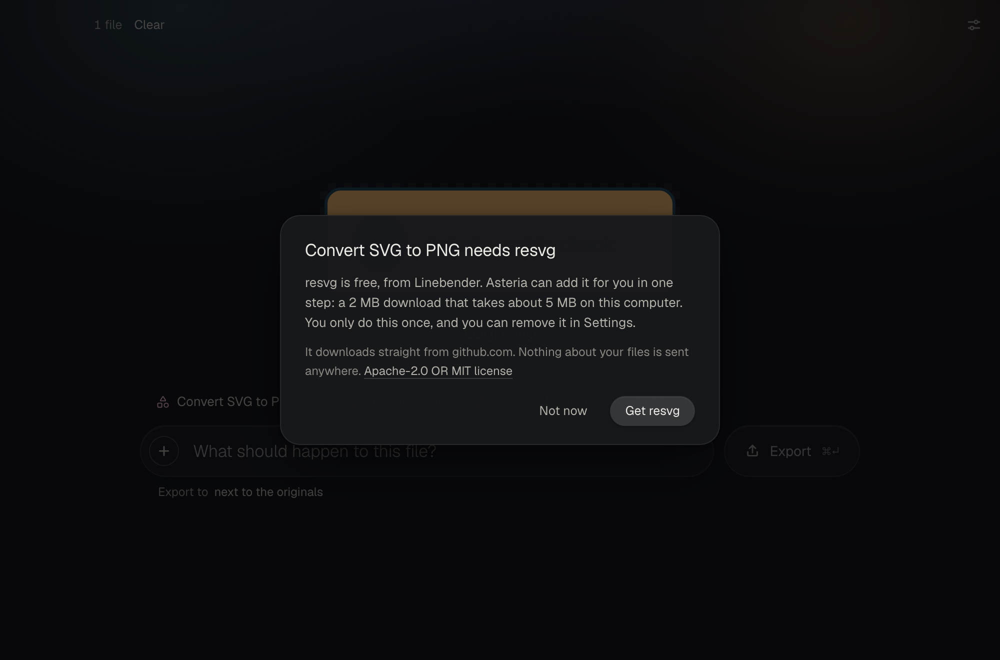
  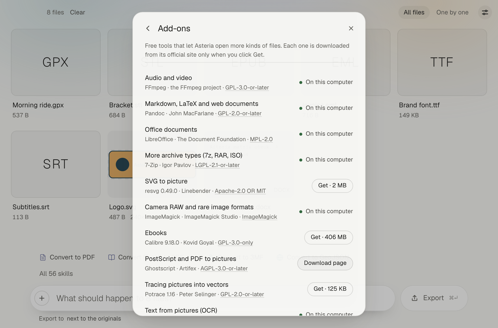
</p>

| Unlocks | Add-on | License | macOS | Windows | Linux |
| --- | --- | --- | --- | --- | --- |
| Audio and video | FFmpeg | GPL-3.0-or-later | one click, 28 MB | one click, 115 MB | one click, 153 MB |
| Markdown, LaTeX and web documents | Pandoc | GPL-2.0-or-later | one click, 43 MB | one click, 43 MB | one click, 36 MB |
| Office documents | LibreOffice | MPL-2.0 | one click, 299 MB | one click, 376 MB | one click, 221 MB |
| More archive types (7z, RAR, ISO) | 7-Zip | LGPL-2.1-or-later | one click, 1 MB | one click, 2 MB | one click, 2 MB |
| SVG to picture | resvg | Apache-2.0 or MIT | one click, 2 MB | one click, 2 MB | one click, 2 MB |
| Camera RAW and rare image formats | ImageMagick | ImageMagick License | download page | one click, 12 MB | one click, 33 MB |
| Ebooks | Calibre | GPL-3.0-only | one click, 406 MB | one click, 291 MB | one click, 241 MB |
| Tracing pictures into vectors | Potrace | GPL-2.0-or-later | one click, 0.1 MB | one click, 0.2 MB | one click, 0.9 MB |
| Text from pictures (OCR) | Tesseract | Apache-2.0 | download page | download page | one click, 24 MB |
| PostScript and PDF to pictures | Ghostscript | AGPL-3.0-or-later | download page | download page | download page |

"Download page" means the project only ships an installer that needs administrator rights (or, for Ghostscript, is AGPL software that's best installed from Artifex directly), so Asteria opens the official download page and picks the tool up once it's installed. Sizes are the downloads; Asteria shows the space each one takes before you click.

## Privacy

Asteria never sends your files anywhere, has no accounts, analytics or telemetry, and works offline. The only time it connects to the internet is when you click to install an add-on, and then only to that add-on's official download host listed in the manifest; nothing about your files is sent. A test ([`privacy_test.go`](privacy_test.go)) checks that only the add-on installer can open network connections and that converting files makes none.

What it keeps on your computer: your settings and how often you use each skill (for ranking), in your user config folder; add-ons you installed, next to them; and work in progress in your user cache folder, deleted when you quit.

## Install

Builds will be on the [Releases](https://github.com/trevor050/asteria/releases) page once the first one is published: a DMG for macOS (Apple Silicon and Intel), an installer for Windows 10 and 11, and a `.deb`, AppImage or tarball for Linux (Ubuntu 24.04, Debian 13 or newer).

The builds aren't signed yet, so your system will warn you the first time:

- **macOS:** "Asteria can't be opened because Apple cannot verify it." Click **Done**, open **System Settings → Privacy & Security**, scroll down and click **Open Anyway** next to Asteria. You only do this once.
- **Windows:** SmartScreen says "Windows protected your PC." Click **More info**, then **Run anyway**.

<p>
  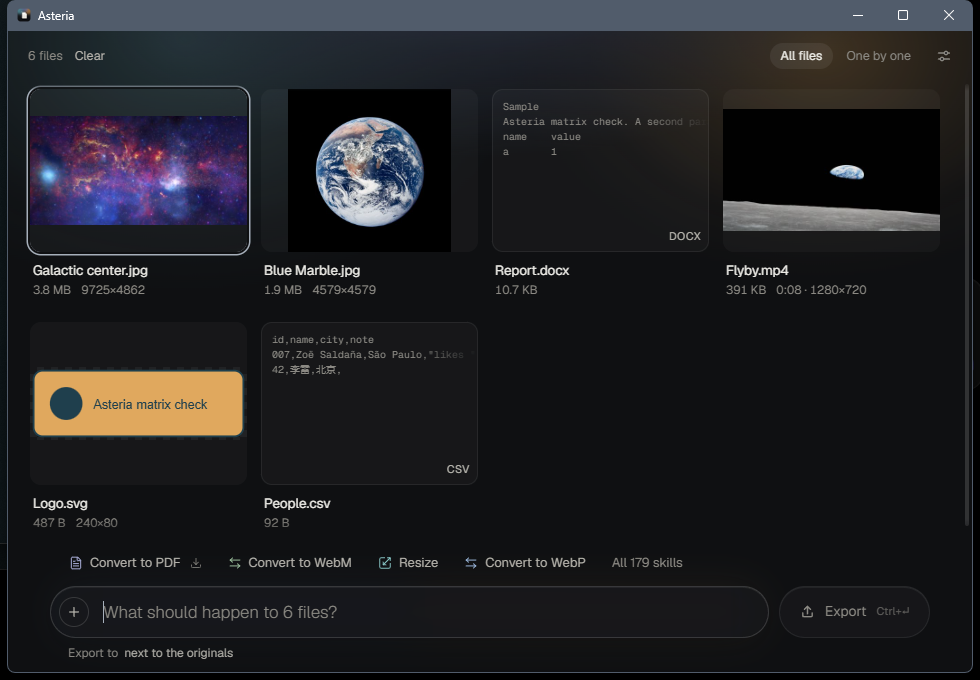
  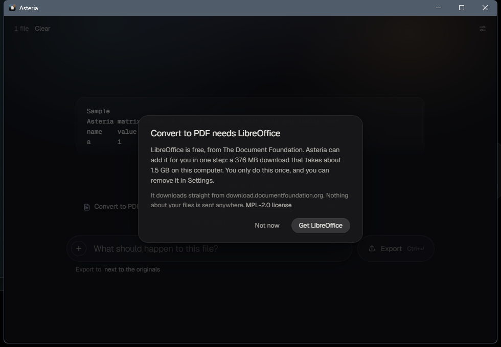
</p>

Platform notes: the Liquid Glass window needs macOS 26; older macOS versions get the regular window. Windows uses the WebView2 runtime that ships with Windows 11 (Windows 10 may ask to install it). The Potrace add-on for macOS is an Intel build and runs through Rosetta on Apple Silicon.

## Make your own skills

Skills are JSON files, and the built-in ones use the same format yours would. Type `open skills folder`, drop in a `.json`, and it shows up immediately. A skill can reuse any built-in operation with different settings, chain other skills, or run an engine. See [skills/README.md](skills/README.md) for the format and [skills/examples](skills/examples) for an example.

## Build from source

You need Go 1.26+, Node 22+ and the Wails 3 CLI (`go install github.com/wailsapp/wails/v3/cmd/wails3@v3.1.0`). On Linux, also `build-essential pkg-config libgtk-4-dev libwebkitgtk-6.0-dev`.

```bash
wails3 dev                                  # run with hot reload
wails3 build                                # build for this machine into bin/
go test -tags nodynamic ./internal/... .    # tests (engine tests run when the engine is installed)
cd frontend && npm run check                # type-check the UI
```

The format matrix behind the numbers above: `ASTERIA_MATRIX=1 ASTERIA_MATRIX_OUT=docs/matrix/<os>-<arch>.json go test ./internal/engine -run TestMatrix -v`, then `node scripts/formats/build.mjs`. The screenshots and the GIF come from the real app driven by a headless Chromium against the server-mode build (`go build -tags server,nodynamic -o bin/asteria-server .`, then `cd scripts/capture && npm install && node capture.mjs readme gif`); the demo photos are NASA's and in the public domain.

Releases: push a `v*` tag and [`release.yml`](.github/workflows/release.yml) builds the macOS DMG, Windows installer and Linux packages into a draft release.

## License

[MIT](LICENSE). The bundled fonts are Geist and Geist Mono (SIL Open Font License), the icons are Lucide (ISC) and PDF pages are drawn with pdf.js (Apache-2.0). Add-ons are separate programs under their own licenses, listed above and in Settings, and are downloaded unmodified from their projects only when you ask.
